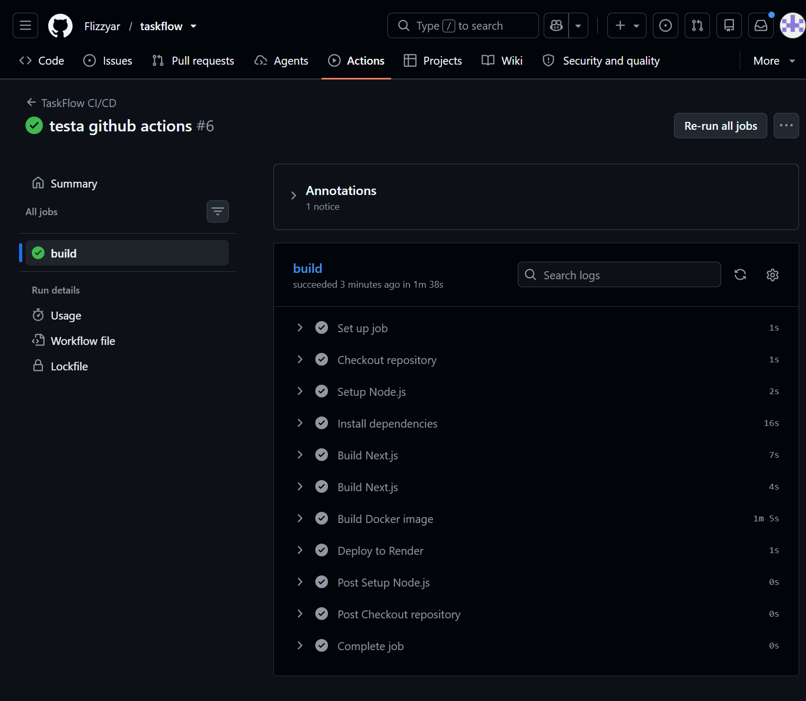
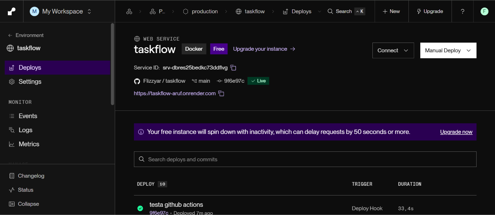
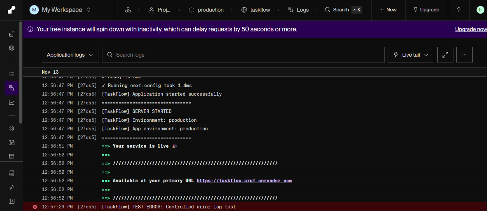

# TaskFlow

## 1. Om applikationen

TaskFlow är en enkel uppgiftshanterare där användaren kan lägga till, visa och slutföra uppgifter. Det går även att se alla uppgifter och endast de slutförda uppgifterna.

## 2. Ramverk och teknik

Jag har använt:

- **Next.js**
- **TypeScript**
- **Tailwind CSS**
- **Docker**
- **Render**
- **GitHub Actions**

Jag valde Next.js eftersom det passar bra för moderna webbapplikationer och är enkelt att arbeta med.

## 3. Starta applikationen lokalt

För att starta projektet lokalt behöver du Node.js och npm.

1. Klona projektet från GitHub.
2. Installera paketen:

```bash
npm install
```

3. Skapa en fil som heter `.env.local` och skriv:

```env
APP_ENV=development
```

4. Starta applikationen:

```bash
npm run dev
```

5. Öppna http://localhost:3000 i webbläsaren.

## 4. Bygga och köra med Docker

Bygg Docker-imagen:

```bash
docker build -t taskflow .
```

Starta containern:

```bash
docker run -p 3000:3000 -e APP_ENV=production taskflow
```

Öppna sedan http://localhost:3000.

## 5. Miljövariabler och hemligheter

Applikationen använder miljövariabeln `APP_ENV` för att veta vilken miljö den körs i.

- Lokalt används `APP_ENV=development`.
- På Render används `APP_ENV=production`.

Jag använder `.env.local` för lokala inställningar. Den filen laddas inte upp till GitHub. I stället finns `.env.example` som visar vilka variabler som behövs.

Render och GitHub Actions hanterar känsliga uppgifter separat. Render Deploy Hook sparas som en GitHub Secret och inte direkt i koden.

## 6. Loggning och Health Check

Jag använder `console.info()` för att visa information när applikationen startar.

Jag använder `console.error()` för att visa fel i loggarna.

Det finns även en health check på:

```text
/health
```

Den kontrollerar att applikationen fungerar och returnerar status, miljö och tidpunkt. Om något går fel returneras ett felmeddelande med statuskod 500.

## 7. GitHub Actions

Jag använder GitHub Actions för att automatisera byggprocessen.

När jag pushar ändringar till `main` körs följande steg:

1. Hämtar projektet från GitHub.
2. Installerar Node.js.
3. Installerar alla paket.
4. Bygger Next.js-applikationen.
5. Bygger en Docker-image.
6. Skickar en begäran till Render för att starta en ny deployment.

Om byggprocessen misslyckas stoppas de efterföljande stegen och GitHub Actions visar vilket steg som gick fel.

## 8. Driftsättning med Render

Jag använder Render för att driftsätta TaskFlow.

Render hämtar projektet från GitHub och bygger applikationen med hjälp av min Dockerfile.

När GitHub Actions har byggt projektet skickas en begäran via en Deploy Hook till Render. Render startar då en ny deployment.

Render använder `/health` för att kontrollera att applikationen fungerar.

## 9. Kostnader och resurser

### Vilken Render-plan använder du?

Jag använder Render Free, alltså gratisplanen.

### Varför har du valt den?

Jag valde gratisplanen eftersom TaskFlow är ett litet skolprojekt. Jag har inte pengar att betala för en dyrare plan och gratisplanen räcker för mitt projekt.

### Vad påverkar kostnaden?

Kostnaden påverkas av hur mycket minne, processorkraft och lagring appen använder samt hur mycket trafik den får.

### Hur kan du minska resursanvändningen?

Jag kan göra koden enklare, optimera bilder och undvika onödiga anrop till servern.

### Vilka begränsningar har din lösning?

Gratisplanen har begränsat minne och appen kan stängas av när ingen använder den. Det kan också ta lite tid att starta den igen.

### Vad skulle du ändra om appen fick fler användare?

Jag skulle behöva mer serverkapacitet, en databas och bättre lagring för att appen ska klara fler användare.

## 10. Länk till applikationen

**TaskFlow:** https://taskflow-aruf.onrender.com

**GitHub:** https://github.com/Flizzyar/taskflow

## 11. Skärmbilder

### GitHub Actions

Visar att byggprocessen och driftsättningen har lyckats.



### Render Deployment

Visar att TaskFlow har driftsatts och att tjänsten är Live.



### Render Logs

Visar applikationens INFO- och ERROR-meddelanden.


